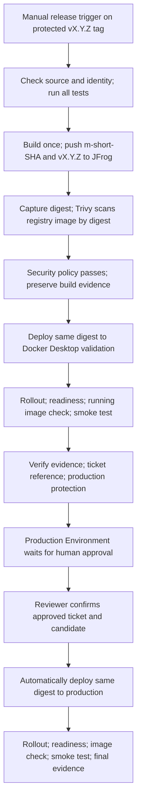

# ML Model Serving Template

Project demo dùng để xây dựng và hiểu flow triển khai một ML model từ một
model artifact có sẵn thành model service chạy trên Kubernetes.

Week 1 baseline đã hoàn thành. Scope hiện tại là Week 2: Security, Versioning,
Audit, Ticket/Approval và Automatic Rollout. Flow serving Week 1 được giữ nguyên:

```text
Existing Model Artifact
        ↓
Artifact Contract Validation
        ↓
Model Adapter
        ↓
FastAPI Model Service
        ↓
Tests
        ↓
Docker
        ↓
Kubernetes
        ↓
Healthcheck / Smoke Test
        ↓
Basic CI/CD
```

Project chủ động đi từ cơ bản đến nâng cao.

Model Registry, scaling, canary, rollback và monitoring expansion vẫn ngoài scope Week 2.

---

# 1. Trạng thái hiện tại

Các kết quả bên dưới là baseline Week 1 đã được ghi nhận trước phiên Week 2;
không phải bằng chứng triển khai release mới qua JFrog hoặc production.
Xem mục 16 trở đi cho flow Week 2 và MANUAL_ACTIONS.md cho cấu hình còn thiếu.

```text
Artifact contract validation     PASS
Model Adapter                    PASS
FastAPI serving                  PASS
Test suite                       PASS
Docker build                     PASS
Docker runtime                   PASS
Non-root container               PASS
Kubernetes deployment            PASS
Readiness probe                  PASS
Liveness probe                   PASS
Kubernetes smoke test            PASS
Basic CI/CD                      WEEK 1 BASELINE
```

Kết quả test baseline Week 1:

```text
54 passed
```

Kubernetes environment hiện tại:

```text
docker-desktop
```

Model service đã được smoke test thành công qua Kubernetes Service:

```text
PASS: GET /health/live
PASS: GET /health/ready
PASS: POST /api/v1/predict -> setosa
SMOKE TEST PASSED
```

---

# 2. Kiến trúc Serving

```text
Client
  │
  │ HTTP
  ▼
FastAPI
  │
  ▼
InferenceService
  │
  ▼
ModelAdapter
  │
  ▼
artifacts/model.joblib
  │
  ▼
sklearn Pipeline
  ├── StandardScaler
  └── LogisticRegression
```

Mỗi layer có trách nhiệm riêng.

## FastAPI

FastAPI chịu trách nhiệm:

- expose HTTP API;
- validate request/response;
- health endpoint;
- chuyển request xuống service layer.

FastAPI không làm việc trực tiếp với sklearn hoặc joblib.

## InferenceService

InferenceService chịu trách nhiệm điều phối inference giữa API layer và
ModelAdapter.

Service layer không cần biết chi tiết model được serialize bằng cách nào.

## ModelAdapter

ModelAdapter chịu trách nhiệm:

- load model artifact;
- kiểm tra artifact contract;
- lấy feature theo đúng thứ tự;
- gọi sklearn Pipeline;
- normalize output của model;
- chuyển raw class ID thành public class name.

Preprocessing đã nằm trong sklearn Pipeline.

Service không được apply `StandardScaler` lần thứ hai.

---

# 3. Model Artifact

Artifact hiện tại:

```text
artifacts/model.joblib
```

Artifact có cấu trúc:

```text
dict
├── model
│   └── sklearn.pipeline.Pipeline
│       ├── StandardScaler
│       └── LogisticRegression
│
└── metadata
```

Artifact được inspect trực tiếp trước khi xây API contract.

## Feature Contract

Số lượng feature:

```text
4
```

Feature theo đúng thứ tự:

```text
sepal_length
sepal_width
petal_length
petal_width
```

Đơn vị:

```text
centimetres
```

Input constraint:

```text
positive finite numbers
```

Batch size:

```text
minimum = 1
maximum = 100
```

## Output Contract

Raw classes của sklearn model:

```text
0
1
2
```

Public class names:

```text
setosa
versicolor
virginica
```

Public API output:

```text
predictions: list of Iris class names
```

## Artifact Runtime Metadata

Artifact metadata ghi nhận:

```text
Python:       3.12.14
scikit-learn: 1.7.2
model:        iris-demo-v1
```

Serving runtime phải duy trì compatibility với serialized artifact.

---

# 4. Project Structure

```text
ml_template/
│
├── artifacts/
│   └── model.joblib
│
├── src/
│   └── model_service/
│       │
│       ├── api/
│       │   └── routes/
│       │       ├── health.py
│       │       └── predict.py
│       │
│       ├── core/
│       │   └── config.py
│       │
│       ├── model/
│       │   ├── adapter.py
│       │   ├── contract.py
│       │   └── errors.py
│       │
│       ├── schemas/
│       │   └── prediction.py
│       │
│       ├── services/
│       │
│       └── main.py
│
├── tests/
│   ├── api/
│   ├── integration/
│   └── unit/
│
├── scripts/
│   ├── readartifact.py
│   ├── release.py
│   └── smoke_test.py
│
├── k8s/
│   ├── configmap.yaml
│   ├── deployment.yaml
│   └── service.yaml
│
├── .github/
│   └── workflows/
│
├── Dockerfile
├── .dockerignore
├── requirements-runtime.txt
├── requirements.txt
├── MANUAL_ACTIONS.md
└── README.md
```

---

# 5. Setup Python Environment

Tạo virtual environment:

```powershell
python -m venv .venv
```

Activate:

```powershell
.\.venv\Scripts\Activate.ps1
```

Cài dependency:

```powershell
python -m pip install --upgrade pip
python -m pip install -r requirements.txt
```

Không cài dependency project trực tiếp vào global Python environment.

---

# 6. Chạy Tests

Set source path:

```powershell
$env:PYTHONPATH="src"
```

Chạy test:

```powershell
python -m pytest -q
```

Kết quả baseline Week 1:

```text
54 passed
```

Test suite bao gồm:

```text
Unit Tests
    ↓
API Tests
    ↓
Artifact Contract Integration Tests
```

Unit test tập trung kiểm tra logic riêng lẻ.

API test kiểm tra HTTP contract.

Artifact integration test sử dụng artifact thật để kiểm tra các invariant
đã được xác minh.

---

# 7. Chạy FastAPI Local

Set runtime configuration:

```powershell
$env:MODEL_PATH="artifacts/model.joblib"
$env:MODEL_NAME="iris-demo-v1"
$env:LOG_LEVEL="INFO"
$env:PYTHONPATH="src"
```

Start service:

```powershell
python -m uvicorn model_service.main:app `
  --host 127.0.0.1 `
  --port 8000 `
  --workers 1
```

Service startup sẽ load model artifact một lần.

Model phải load thành công trước khi service được xem là Ready.

---

# 8. API Endpoints

## Liveness

```text
GET /health/live
```

Dùng để xác định application process còn hoạt động hay không.

## Readiness

```text
GET /health/ready
```

Dùng để xác định model service đã sẵn sàng nhận inference request hay chưa.

Ví dụ:

```text
process chạy
nhưng artifact load thất bại
```

thì:

```text
/live  → có thể PASS
/ready → phải FAIL
```

## Prediction

```text
POST /api/v1/predict
```

Request phải tuân theo artifact contract đã xác minh.

---

# 9. Smoke Test

Smoke test:

```powershell
python scripts/smoke_test.py `
  --base-url http://127.0.0.1:8000
```

Smoke test kiểm tra:

```text
GET  /health/live
GET  /health/ready
POST /api/v1/predict
```

Nếu bất kỳ bước nào lỗi, script trả exit code khác `0`.

Điều này cho phép cùng một script được dùng ở:

```text
Local
Docker
Kubernetes
CI/CD
```

---

# 10. Docker

## Build Image

Developer-only check. Release builds are owned exclusively by `release.yml`;
never rebuild this development image in CD or use it as release evidence.

```powershell
docker build -t model-service:dev .
```

Runtime dependency được tách riêng tại:

```text
requirements-runtime.txt
```

Các dependency phục vụ test không cần nằm trong production image.

## Run Container

```powershell
docker run --rm -d `
  --name ml-template-validation `
  -p 18000:8000 `
  -e MODEL_PATH=/app/artifacts/model.joblib `
  -e MODEL_NAME=iris-demo-v1 `
  -e LOG_LEVEL=INFO `
  model-service:dev
```

## Smoke Test Container

```powershell
python scripts/smoke_test.py `
  --base-url http://127.0.0.1:18000
```

Kết quả đã được xác minh:

```text
PASS: GET /health/live
PASS: GET /health/ready
PASS: POST /api/v1/predict
SMOKE TEST PASSED
```

## Kiểm tra Runtime User

```powershell
docker exec ml-template-validation id
```

Runtime đã xác minh:

```text
uid=10001(app)
gid=10001(app)
```

Container không chạy bằng `root`.

## Xem Logs

```powershell
docker logs ml-template-validation
```

Startup đã được xác minh:

```text
Loading model artifact
Model artifact ready
Application startup complete
```

## Stop Container

```powershell
docker stop ml-template-validation
```

## Optional runtime/artifact packaging (local preparation)

The existing `Dockerfile` remains the combined image used by the current release
flow. Two additional Dockerfiles prepare independent runtime and artifact images:

- `Dockerfile.runtime` uses the same Python, dependencies, non-root user and
  single Uvicorn worker, with no bundled model. Set `MODEL_PATH` to an externally
  supplied file; the application continues to load it directly from the filesystem.
- `Dockerfile.artifact` packages the existing trusted bundle unchanged at
  `/artifact/model.joblib`. Its default command copies it to `/models/model.joblib`
  with read permissions for the runtime user. Mount a writable volume at `/models`
  for this handoff, then mount the same volume read-only in the runtime container.

Artifact `model_version` is an identity, such as `iris-demo-v1` or `iris-demo-v2`.
It must start with an ASCII letter or digit and contain only ASCII letters, digits,
`.`, `_`, `+` or `-`. It is retained in the artifact contract and readiness log.
The supported Iris features, targets, units, signatures, batch bounds, pipeline,
class mapping and sklearn checks remain strict. Artifact Python metadata still
requires `3.12.14`; a different runtime Python version still produces a warning.

Local PowerShell verification (use an unused container name and port):

```powershell
docker build -f Dockerfile.runtime -t model-runtime:test .
docker build -f Dockerfile.artifact -t model-artifact:test .
$modelVolume = docker volume create
try {
  docker run --rm --mount "type=volume,source=$modelVolume,target=/models" model-artifact:test
  docker run --rm -d --name ml-template-split-validation `
    -p 18001:8000 -e MODEL_PATH=/models/model.joblib `
    --mount "type=volume,source=$modelVolume,target=/models,readonly" model-runtime:test
  # After the service reports application startup complete:
  docker logs ml-template-split-validation
  python scripts/smoke_test.py --base-url http://127.0.0.1:18001
} finally {
  docker rm -f ml-template-split-validation
  docker volume rm $modelVolume
}
```

These are local packaging checks. Building/pushing both image types, carrying both
immutable digests, initContainer/shared-volume deployment wiring, dual-image release
evidence and verification of both deployed digests belong to a future infrastructure
task. The current release workflow still uses its single `exact_deploy_image`.

---

# 11. Kubernetes

Môi trường hiện tại:

```text
Docker Desktop Kubernetes
```

Context:

```text
docker-desktop
```

Kiểm tra cluster:

```powershell
kubectl config current-context
kubectl get nodes
kubectl cluster-info
```

Node hiện tại phải ở trạng thái:

```text
Ready
```

---

# 12. Kubernetes Resources

Scope hiện tại sử dụng ba object chính:

```text
ConfigMap
Deployment
Service
```

## ConfigMap

ConfigMap chứa runtime configuration không nhạy cảm:

```text
MODEL_PATH
MODEL_NAME
LOG_LEVEL
```

Secret không được đặt trong ConfigMap.

## Deployment

Deployment quản lý Pod của model service.

Release deployment dùng identity lấy từ `release.json`:

```text
<configured JFrog image name>@sha256:<digest>
```

`RELEASE_IMAGE_REQUIRED` trong manifest là placeholder. Release helper render
image trước khi apply. Không apply trực tiếp placeholder. Kubernetes cần
`model-service-registry` imagePullSecret trong namespace đích.

Deployment cấu hình:

```text
containerPort: 8000
readinessProbe: /health/ready
livenessProbe:  /health/live
runAsNonRoot:   true
```

## Service

Service tạo endpoint ổn định phía trước Pod.

Current type:

```text
ClusterIP
```

Service route traffic tới Pod dựa trên label selector.

---

# 13. Deploy Kubernetes

Week 2 deployment is driven by **Actions > Release > Run workflow** on a release
tag. The reusable `cd-local.yml` consumes the scanned release evidence and image
digest from that run. It does not build an image.

The helper renders `k8s/deployment.yaml` with `kubectl set image --local`, applies
the rendered manifest, waits for rollout and readiness, checks the running pod
image digest, and invokes the existing smoke test. It explicitly targets the
configured namespace and `docker-desktop` context for local validation.

Complete [MANUAL_ACTIONS.md](MANUAL_ACTIONS.md) before running a release.
Docker Desktop is validation only. Production requires a separate real target.

---

# 14. Test Model Service trên Kubernetes

Port-forward Kubernetes Service:

```powershell
kubectl port-forward service/model-service 18000:8000
```

Terminal khác:

```powershell
python scripts/smoke_test.py `
  --base-url http://127.0.0.1:18000
```

Kết quả đã được xác minh:

```text
PASS: GET /health/live
PASS: GET /health/ready
PASS: POST /api/v1/predict -> setosa
SMOKE TEST PASSED
```

Flow được kiểm chứng:

```text
Client
  ↓
Kubernetes Service
  ↓
Pod
  ↓
FastAPI
  ↓
InferenceService
  ↓
ModelAdapter
  ↓
Model Artifact
  ↓
Prediction
```

---

# 15. Tại sao sử dụng Kubernetes?

Docker giải quyết việc đóng gói application thành một runtime có thể chạy.

Kubernetes quản lý lifecycle của runtime đó.

Kubernetes hỗ trợ:

```text
Deployment
Pod lifecycle
Healthcheck
Workload replacement
Rollout
Stable Service endpoint
```

Kubernetes không tự sửa application code hoặc configuration sai.

Kubernetes hoạt động theo nguyên tắc:

```text
Desired State
      ↓
Kubernetes Controller
      ↓
Actual State
```

Ví dụ:

```text
Desired:
1 Pod

Actual:
0 Pod

Kubernetes:
→ tạo Pod
```

Khi Deployment thay đổi, Kubernetes tạo workload mới để đưa actual state
về desired state mới.

---

# 16. Week 2 controlled release flow

**Confirmed by the mentor:** "Ticket will be the gate for production. It must be
approved before it can go to production."

**Proposed demo design:** all automatic checks and local validation pass before
requesting human production approval. The reviewer verifies the ticket approval
against the exact candidate version and digest. GitHub then resumes deployment
automatically. These mechanics are a proposal for mentor review, not confirmed
company policy. Security thresholds, ticket states and company approver rules
remain unknown.



The ticket reference is checked early to avoid wasting a build, and checked again
as part of candidate evidence. The authoritative Ticket Gate remains immediately
before production, after validation. No input such as `approved=true` exists.
No ticket API or automatic ticket approval is simulated.

## Workflow responsibilities

| File | Responsibility |
| --- | --- |
| `.github/workflows/ci.yml` | PR/main tests on a hosted runner, without deployment secrets. |
| `.github/workflows/release.yml` | Manual tagged release: tests, one build/push, blocking scan, validation, candidate, protected production, audit. |
| `.github/workflows/cd-local.yml` | Reusable Windows/Docker Desktop validation, called by Release with the fixed digest. |
| `scripts/release.py` | Identity and evidence checks, protection checks, shared digest-only deployment; no model-specific logic. |

Release tests run again at the tagged SHA even if PR CI passed earlier. CI no
longer builds a throwaway `:ci` image that could be mistaken for a release.
The existing model contract, liveness/readiness probes and smoke test remain intact.

## Identity and Build Once

- Source: a `vX.Y.Z` Git tag whose commit is reachable from `origin/main`.
- Build tag: `m-<12-character git SHA>`.
- Release tag: `vX.Y.Z` on the same image.
- Deployment: `<JFrog image name>@sha256:<64 hexadecimal characters>`.

There is one build/push action, producing a single `linux/amd64` manifest. Its
returned registry digest becomes `exact_deploy_image`. Trivy reads that digest
from the registry; validation and production compare it with the same build
artifact and source SHA. CD only checks out manifests/scripts and downloads
evidence. It never resolves a mutable tag or rebuilds the image.

The demo refuses existing build/release tags and disables workflow reruns.
Use a new source commit and version after a failed release; never move a tag or
replace the image behind an existing release. Registry tag protection is also
required. This intentionally simple retry policy avoids accidentally rebuilding
an established release. Reusing evidence for deployment retries is outside this
proposal.

## Proposed automatic eligibility rules

All of these must pass before the production job can request approval:

1. Allowed manual tag trigger, strict `vX.Y.Z`, main ancestry, exact checkout SHA,
   first workflow attempt, non-empty ticket reference and valid explicit policy.
2. All tests pass and JUnit evidence exists.
3. Registry preflight succeeds, identity is unused, one build/push succeeds,
   and a valid digest is captured.
4. Trivy scans the registry image by that digest and exits successfully under
   `TRIVY_BLOCKING_SEVERITIES` and `TRIVY_IGNORE_UNFIXED`. Neither has a silent
   default. Scanner/database/authentication failures also block the release.
5. Validation applies the same digest, rollout succeeds, the deployment and pods
   become ready, running images match, and the existing smoke test passes.
6. Build/scan/test/validation evidence exists and matches the same release/run.
7. The production Environment API reports reviewers, prevent self-review,
   disabled administrator bypass and exactly the selected `v*` tag policy.

The API protection check fails closed on missing settings, inaccessible API or
unknown response. GitHub itself enforces approval. Protection settings must stay
in place throughout the release; repository administrators remain trusted.

## Ticket Gate and human action

The candidate artifact contains the version, source SHA, image digest, scan
policy/results, validation result, ticket reference and workflow URL. The human
reviewer reads this evidence, retrieves the referenced ticket in the real process,
and confirms it is approved for this release and production before clicking
**Approve and deploy** in GitHub. One of the configured reviewers is sufficient
under GitHub's native mechanism; company requirements for multiple approvals are
not known. See [GitHub environment protection documentation](https://docs.github.com/en/actions/how-tos/deploy/configure-and-manage-deployments/manage-environments).

The protected job receives its environment secrets only after the gate passes.
It then deploys automatically, without another dispatch or image build. No
approval leaves it waiting; rejection prevents deployment. A production failure
fails the release and retains failure evidence. There is no automatic rollback.

## Failure semantics and audit

| Condition | Result |
| --- | --- |
| Tests, registry, digest, scan or required evidence fail/missing | Validation/candidate cannot pass; no production approval request. |
| Apply, rollout, readiness, image check or smoke fails | Failure evidence; no production candidate. |
| Ticket missing or protection rules absent/unknown | Fail closed before production. |
| Approval pending | No production job execution or access to its protected secrets. |
| Approval rejected | Production does not execute; GitHub records rejection. |
| Approval granted | Same immutable image deploys automatically. |
| Production verification fails | Release is not successful; operator investigates, no automatic rollback. |

Artifacts are retained for 30 days (proposed demo retention): `release-build-*`,
`release-validation-*`, `release-candidate-*`, `release-production-*`, and
`release-audit-*`. JSON records source/full and short SHA, version, image name/tag/
digest/exact deploy image, workflow run, timestamp, security result/policy,
ticket reference, environment, deployment checks/result and approval state where
observable. The build artifact also contains JUnit and Trivy JSON. The GitHub
Environment history is authoritative for reviewer identity, approval/rejection
and comments; the helper does not fabricate these fields or ticket approval.

An always-run audit job aggregates terminal job outcomes. Failed/cancelled/skipped
jobs cannot produce release success. A rejected job cannot upload a production
artifact because none of its steps run. While approval is pending, inspect the
candidate and native GitHub status. Runner loss or forced workflow cancellation
may prevent artifact finalization; absence of evidence is never success.

One workflow-level concurrency group serializes the shared validation target and
production, including approval waits. It never cancels an active release to
start a newer one. GitHub may replace an older pending run when more runs are
queued; this is serialization, not a guaranteed FIFO release queue. Only dispatch
one candidate at a time.

# 17. Setup, limitations and Week 2 boundaries

Follow [MANUAL_ACTIONS.md](MANUAL_ACTIONS.md) for JFrog configuration, security
policy variables, protected release tags, reviewers, Kubernetes pull secrets,
runner labels, production credentials and the future ticket-validation contract.

The default registry host is `jfrog.vinsmartfuture.tech`. Its repository path,
credentials and network access are external configuration. This repository does
not substitute another registry or provision a production cluster. YAML alone
does not prove the GitHub Environment is protected or that a release was deployed.

Week 2 covers Security, Versioning, Audit, Ticket/Approval, Build Once and
Automatic Rollout. MLflow, Model Registry, model artifact expansion, adapters,
HPA, canary, automatic rollback, Helm, EKS, observability expansion and large
security platforms remain outside scope.
