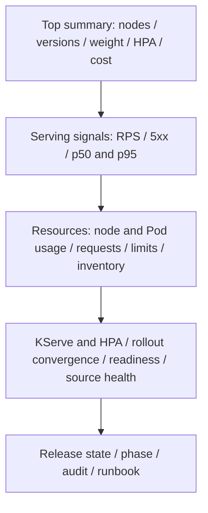
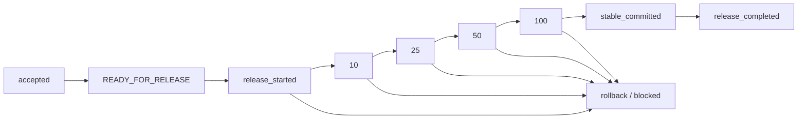

# MLOps v2 — Infrastructure & Serving

Status: **PARTIAL — offline implementation verified; live rollout BLOCKED by monitoring topology prerequisites and owner approval.** No live resources were changed for this dashboard task. No serving traffic was generated.

Dashboard UID `mlops-v2-infra-serving`; folder `MLOps v2`; 28 panels; immutable UI edits; refresh30s; default last1h. Source of truth: `k8s/monitoring/grafana/dashboards/mlops_v2_infra.json`. `scripts/build_dashboard_v2.py` reproducibly generates that JSON and ConfigMap. `scripts/mockup_dashboard_v2.py` produces the PNG/SVG design mockup; **these are not live screenshots**.

## Layout





## Verified inventory — 2026-10-09 Asia/Saigon

Repository branch `feat/canary-monitoring-demo`, baseline HEAD `c604c3a339774772829d725ef1eb972c844e1da3`. Existing uncommitted runner changes were preserved and are not part of the dashboard commit.

- Context `ml-template-dev-sg`, application namespace `production`, six Ready nodes.
- Stablev6, no active candidate, weight0. v5/v7 remain failed for insufficient_canary_traffic. No state was edited.
- Stable HPA1–2, CPU80%; Canary1–1. Both ISVCs Ready; no claim of autoscaling acceptance.
- **Namespace monitoring does not exist. No ServiceMonitor CRD, Prometheus Operator or monitoring Helm release exists on this cluster.** Old repository P0 notes refer to a different historical installation.
- Actual standalone Grafana12.2.0 and Prometheus3.15.0 run in production. Grafana has no sidecar; one existing dashboard UID `local-canary`. P0 UID `ml-model-service-p0` is present in source but absent from the live dashboard search. Neither legacy dashboard source was modified.
- Existing provisioned datasource: Prometheus / `canary-prom` / `http://prometheus:9090`. No duplicate datasource file was created. Dashboard uses `${DS_PROMETHEUS}` instead of pinning that UID.
- Grafana data512Mi emptyDir, Prometheus data1Gi emptyDir. Their config/provider/dashboard ConfigMaps are immutable. Restarting may lose unprovisioned state/history; do not replace/reset these resources as a shortcut.
- Router-v2 is already scraped by the standalone Prometheus as job `credit-risk-router-v2`. Its deployed image predates ReleaseCollector. No second release-gauge exporter was introduced.

## Metrics and interpretation

|Source|Needed for|Current availability|
|---|---|---|
|Router-v2|RPS, errors, latency, weight, state age|4 metric families present|
|Existing ReleaseCollector in Router-v2|Versions, phase, pending, audit timestamps|Code exists, live router revision does not expose it|
|kube-state-metrics|Node/Pod inventory, requests/limits, Deployment/HPA state|Absent|
|kubelet/cAdvisor|Actual CPU and memory|Not scraped|
|Optional model-state exporter|ISVC Ready/generation/mode/revision, new audit counters|Built/tested/scanned locally, not deployed|

All70 panel/annotation expressions returned successful Prometheus API responses. Only5/44 referenced metric families currently exist. **Query syntax PASS does not mean panel data PASS.** Live zero-traffic check: both track RPS0, error ratio empty, p50/p95 empty. Source-presence panels intentionally report absent sources as0, never serving health. Error/latency never use zero-fill or artificial denominators.

Pod inventory joins KSM Pod identity/phase/readiness/restarts; resources have separate usage/request/limit and ratio panels. Missing or zero request/limit yields NO DATA. Node usage uses root cgroup with a verified `node` scrape label; do not sum parent and child cgroups. HPA experimental target metric families must be verified against the installed KSM before claiming accuracy. Namespace variable defaults production; Router metrics remain explicitly scoped to the production v2 job. Model is currently the supported credit-risk constant. Pod-prefix, node and track filters support All.

ISVC Ready alone is **not rollout proof**. Compare metadata/observed generation and Deployment generation/observed/desired/updated/ready/available. Identity acceptance separately reads model-version annotation, initializer URI and runtime digest, never labels them in Prometheus. Standard-mode missing revision is `N/A`.

The new exporter reads only two named InferenceServices and one named ConfigMap. It does not expose existing release gauges. Startup baselines retained audit; only newer timestamps increment bounded reason/stage counters. Restart does not replay history. Unknown reasons become `other`; API failure/staleness sets exporter_up0 and omits status values. Audit history is bounded: exporter downtime may miss evicted events; counters are operational annotations, not an authoritative durable audit ledger. The controller currently logs recovery blocking without an audit `release_blocked` row: use release phase BLOCKED for that condition, not an invented event.

Operational conditions are dashboard panels only; no notification routing or alert-rule resources are enabled.

## Cost

AWS Pricing GetProducts succeeded: `t3.medium`, Linux, Shared, no preinstalled software, Asia Pacific(Singapore), On-Demand **USD0.0528/hour**. The API evidence is retained. Dashboard formula is live `count(kube_node_info) * ${node_hourly_usd:raw} *730`; no hardcoded node count. Six homogeneous nodes would estimate USD231.26/month. This is **EC2 compute estimate only**, excludes EKS/EBS/transfer/tax/T3 Unlimited CPU credits, and assumes all counted nodes match that instance type. Reverify rate and fleet composition before relying on it. No IAM change was needed or requested.

## Offline validation

```powershell
.\.venv\Scripts\python.exe scripts/build_dashboard_v2.py
.\.venv\Scripts\python.exe -m pytest tests/test_grafana_dashboard_v2.py tests/test_model_state_exporter.py -q
.\.venv\Scripts\python.exe -m pytest -q
.\.venv\Scripts\python.exe -m scripts.validate_dashboard_v2 --output ci-validation
.\.venv\Scripts\python.exe -m scripts.render_dashboard_v2 --image <approved-repository@sha256> --output ci-validation/dashboard-v2-render.json
```

Focused tests8PASS; full regression750PASS,2existing deprecation warnings. Existing runner's uncommitted HPA-aware check contributes one preexisting test beyond committed baseline741. Control-plane image context now includes only reviewed exporter Python files; initial import test detected the old allowlist omission, which was fixed before scanning.

Local candidate index `sha256:aa4181ff27c3ebbd64d6dec748875ad723a625831f9ce61e2f36a3aa8e43e631`, image config ID `sha256:cd21d1ba62f0ce7a46c3625b3a34b4c70e56b9093bf3287f6650f3e2b49172a4`. Non-root UID10001, read-only filesystem, network-none import smoke PASS. Trivy0.70.0 exact-image archive: HIGH/CRITICAL0, no ignores. **Not pushed to ECR**; the rendered registry reference is a candidate publication target, not proof of registry availability.

Conditional kube-prometheus-stack91.9.0 OCI digest `sha256:04047e500c803dc8d2bc284ecb43e9229bb32b5c36bd13fc89592c8a2f3cdc72` renders53 objects with the folder values overlay. This is a compatibility render, **not an approved new installation**. Do not install a second stack to bypass the inventory mismatch. The desired folder settings are confirmed in rendered provider config; source JSON remains authoritative and allowUiUpdates=false.

## Approval boundary and exact resource diff

See `ci-validation/dashboard-v2-render.json` and `dashboard-v2-rbac-review.yaml`.

Prepared resources, conditional on the selected monitoring topology:

1. monitoring ConfigMap `mlops-v2-infra-dashboard`: one UID/folder, legacy untouched.
2. monitoring ServiceMonitors `credit-risk-router-v2`, `mlops-v2-state-exporter`: release label ml-observability,15s named-port scrapes. These do nothing on the current standalone Prometheus and cannot be created until CRDs/namespace exist.
3. production ServiceAccount, Role, RoleBinding, Deployment and Service named `mlops-v2-state-exporter`: get-only exact-resource RBAC;20m CPU/32Mi requests,100m/96Mi limits; no AWS identity.
4. Router Service metadata label app=credit-risk-router-v2 and port name http. Standalone scrape already exists; this is preparation for Operator discovery, not a duplicate active scrape.
5. A separately reviewed router image update is required for existing ReleaseCollector metrics. Do not apply the full control-plane renderer: its disabled defaults would affect unrelated workloads. Only a targeted router patch may be approved later.
6. Grafana folder overlay applies only to a verified Helm sidecar deployment. Current Grafana has no sidecar; applying it with Helm now would create a new stack, not update existing Grafana.

**No deployment bundle is currently safe to apply as a complete solution.** Owner must choose/review the monitoring topology: adapt the current immutable-config standalone stack with a preservation/migration plan, or explicitly authorize an isolated monitoring installation with source and dashboard ownership clarified. That prerequisite has not been silently expanded into this dashboard task. Grafana restart for a future sidecar/mount migration: required/needs preservation review, not approved. Prometheus restart for dashboard provisioning: not required and forbidden; adding absent metric sources needs a separate reviewed configuration plan. No blanket Helm upgrade command is offered against the wrong installation.

The8 prepared dashboard/exporter objects alone add only one20m/32Mi exporter Pod. A new Helm installation would add substantially more workloads, cluster RBAC/CRDs/webhooks, and need its own capacity/credential/security review; its53-object inventory is supplied for comparison, not authorization.

## Rollback after a separately approved rollout

Only run after recording which named resources were newly created and backing up any preexisting objects. Do not delete shared CRDs or a Helm release automatically.

```powershell
# Only the newly created dashboard ConfigMap; removes only this provisioned dashboard.
kubectl --context ml-template-dev-sg -n monitoring delete configmap mlops-v2-infra-dashboard
kubectl --context ml-template-dev-sg -n monitoring delete servicemonitor credit-risk-router-v2 mlops-v2-state-exporter
kubectl --context ml-template-dev-sg -n production delete deployment,service,serviceaccount,role,rolebinding mlops-v2-state-exporter
```

For targeted router Service/image changes, restore captured pre-change manifests/resourceVersion-reviewed patches; do not roll back an entire control-plane render. A Helm/Grafana provider migration must have its own saved values, backup and rollback plan before approval. No such live migration happened here.

## Evidence and live acceptance

Detailed evidence is LOCAL ONLY (not committed to the public remote): `evidence/mlops-v2-dashboard/20261008T200245Z/`; UTC timestamp corresponds to2026-10-09 Asia/Saigon. `ci-validation/` holds PromQL, metric presence, rendered resource and RBAC artifacts. Mockups under `docs/assets/` are design artifacts. Requested `dashboard-full.png`, `dashboard-top.png`, `dashboard-resources.png`, `dashboard-serving.png`, `dashboard-release.png` are **NOT_RUN** until a real approved deployment; they are not filled with mockups.

After topology/prerequisites and exact rollout are approved: verify all new targets UP, old targets retained, dashboard UID exactly once, legacy retained, namespaceproduction selected, node/Pod/HPA/ISVC/state values match live API, zero-traffic NO DATA semantics, and capture actual screenshots. No inference/load is needed for dashboard query validation. Autoscaling GateC remains paused until observability is live and these checks pass.

## Safety for this dashboard task

Release-state mutation: NONE. Model promotion: NONE. ServingPair change: NONE. Canary weight change: NONE. HPA policy change: NONE. Nodegroup change: NONE. AWS IAM change: NONE. Live changes: NONE. No load test was rerun.

References: [Grafana provisioning](https://grafana.com/docs/grafana/latest/administration/provisioning/), [KSM HPA metrics](https://github.com/kubernetes/kube-state-metrics/blob/main/docs/metrics/workload/horizontalpodautoscaler-metrics.md), [Prometheus histograms](https://prometheus.io/docs/practices/histograms/).

Public-repository boundary: automatic approval review rejected publishing raw cluster/Grafana/Prometheus evidence. Repository visibility was verified public. Source, tests, manifests and design mockups can be reviewed independently; raw query/target/workload evidence and ci-validation artifacts remain local pending explicit owner approval for public disclosure.
